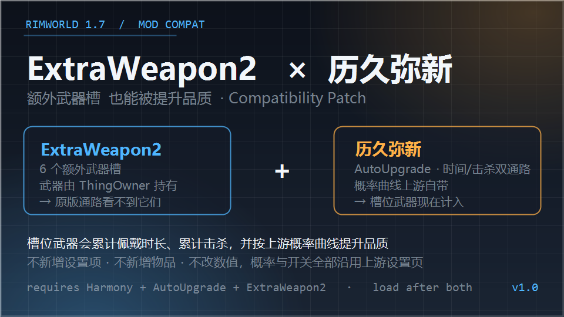

# ExtraWeapon2 × 历久弥新（Auto Upgrade）兼容

让装在 **ExtraWeapon2** 额外武器槽里的武器，也能被 **历久弥新（Auto Upgrade）** 正常提升品质。

- 目标版本：RimWorld 1.7
- 依赖：Harmony、`hoxise.AutoUpgrade`（Steam 3577932060）、`MRK.ExtraWeapon2`（Steam 3692964069）
- 加载顺序：必须排在上面两个模组之后（`About.xml` 已声明 `loadAfter`）
- 创意工坊：<https://steamcommunity.com/sharedfiles/filedetails/?id=3845175906>
- 源码仓库：<https://github.com/MoXInHUA0209/ExtraWeapon2AutoUpgradeCompat>



---

## English

A compatibility shim that makes **Auto Upgrade** (历久弥新) recognize weapons stored in **ExtraWeapon2**'s
extra weapon slots.

*Requires:* Harmony, `hoxise.AutoUpgrade`, `MRK.ExtraWeapon2`. RimWorld 1.7. Load after both mods.

ExtraWeapon2 holds slotted weapons in its own `ThingOwner`, while Auto Upgrade only walks
`Pawn_EquipmentTracker` and worn apparel. So those weapons never entered the usage dictionary
(`UsageRecord.UpdateEquipmentUsage`) and never got a quality roll
(`AutoUpgradeComp.ExecuteQualityUpgradeLogic`), leaving them stuck at their original quality forever.

This mod adds three hooks, all reusing Auto Upgrade's own data and numbers:

1. **Carried time** — `UsageRecord.UpdateEquipmentUsage` prefix/postfix: accumulate slotted weapons
   into Auto Upgrade's own dictionary with its own `GetEquipmentKey` and its own delta formula,
   so persistence comes for free.
2. **Time-based upgrade** — `AutoUpgradeComp.ExecuteQualityUpgradeLogic` postfix: roll with
   `ProbabilityUtils.GetUpgradeProbability` and `CommonUtils.GetNextQuality`, same gate as upstream.
3. **Kill-based upgrade** — `Pawn.Kill` postfix: attribute the kill to the slotted weapon whose def
   matches and which fired most recently, then use its `CompKillTracker` and `KillUpgradeUtils.NeedKillCount`.

No new settings, items, or balance changes — the toggles and odds stay entirely in Auto Upgrade's
options page. Private members are reflected only where required, each with a fallback, and each hook
is installed independently so one failure does not disable the others.

See the Chinese sections below for the full root-cause analysis, known trade-offs, build command and
in-game acceptance steps.

---

## 问题是怎么来的

读两个模组的程序集（`AutoUpgrade.dll` 1.0.0.0、`ExtraWeapon2.dll` 1.7）得到的结论：

1. `ExtraWeapon2` 把额外武器放在自己的 `ThingOwner` 里，由 `ExtraWeaponComponent`（在 `PatchMain` 的 `[StaticConstructorOnStartup]` 里注入到所有人形 `ThingDef`）持有。
2. 历久弥新的两条通路都只认原版容器：
   - `UsageRecord.UpdateEquipmentUsage` 只遍历 `Find.Maps` 中 `IsPlayerHome` 地图上自由殖民者的 `equipment.AllEquipmentListForReading` 与 `apparel.WornApparel` → 槽位武器从不进入"携带时长"字典；
   - `AutoUpgradeComp.ExecuteQualityUpgradeLogic` 只对 `equipment.Primary` 与 `WornApparel` 掷骰 → 槽位武器从不进入品质判定；
   - `KillRecord.Postfix`（挂 `Pawn.Kill`）只把击杀记到 `equipment.Primary` → 槽位武器的 `CompKillTracker` 一直是 0。

结果：槽位武器虽然有 `CompQuality`，但既没有佩戴时长也没有击杀计数，永远停在原品质。

## 本模组做的事

| 通路 | 挂点 | 行为 |
| --- | --- | --- |
| 携带时长 | `UsageRecord.UpdateEquipmentUsage` 前后置 | 在同一份 delta（`Math.Max(RecordInterval, TicksGame - LastRecordTick)`）里，把槽位武器按上游自己的 `GetEquipmentKey` 写进上游自己的字典 → 随上游存档持久化，不新增存档字段 |
| 时间升级 | `AutoUpgradeComp.ExecuteQualityUpgradeLogic` 后置 | 用上游的 `ProbabilityUtils.GetUpgradeProbability` 与 `CommonUtils.GetNextQuality` 对槽位武器掷骰，门槛（CurrentMap 必须是本土地图、只算自由殖民者）与上游一致 |
| 击杀升级 | `Pawn.Kill` 后置 | 击杀归给"def 匹配且最近开火"的槽位武器，计数写进上游的 `CompKillTracker.IncrementKillCount`，阈值用 `KillUpgradeUtils.NeedKillCount` |

设计约束：

- 不加设置项、不加物品、不改数值。概率、开关、击杀阈值全部由历久弥新的设置页控制；把「启用装备自动升级」或「按击杀升级」关掉，本模组同步沉默。
- 不碰主武器与衣物通路（那段完全交给上游）。
- 私有成员只在必须时反射（`RecordInterval`、`LastRecordTick`、`CompKillTracker.killCount`），每个都有兜底：反射失败时功能降级、只报一条警告，不刷屏、不崩。

## 已知取舍

- 伤害信息只携带武器 `ThingDef` 而不携带实例，所以同型号多把槽位武器并存时按 `LastAttackTargetTick` 归属（即"刚刚开火的那把"）。极端情况下可能算到同型号的另一把，只影响哪一把升品质。
- 槽位武器被视作"一直携带"（无论是否征召），与历久弥新对普通装备的判定口径一致。
- 首轮记录沿用上游的补满逻辑（首次运行会一次补上 `TicksGame` 那么多 tick），这是上游对普通装备的既有行为，此处刻意保持一致，不额外修正。
- 上游 `ExecuteQualityUpgradeLogic` 只看 `Find.CurrentMap` 是否本土地图；为了"和普通装备手感一致"，本模组沿用同一门槛，因此查看非本土地图时槽位武器同样不会升级。

## 构建

```
powershell -File E:\mod\rim_mod\.build\build-ew2-au-compat.ps1
```

无需 .NET SDK：脚本用 `.build\tools` 里的 Roslyn csc + .NET 10 参考程序集，
引用游戏根目录的 `Assembly-CSharp.dll` / `UnityStubs.dll` / `Waylith.dll`，
以及 `0Harmony.dll`、`ExtraWeapon2.dll`（1.7）、`AutoUpgrade.dll`，输出到 `Assemblies\`。

## 验证状态

- 已做：编译通过（0 error / 0 warning）；上游三个挂点的存在性、签名、字段名用 Cecil 逐个核对（`UsageRecord.UpdateEquipmentUsage`、`AutoUpgradeComp.ExecuteQualityUpgradeLogic`、`Pawn.Kill(DamageInfo?, Hediff)`、字段 `RecordInterval`/`LastRecordTick`/`killCount`，以及 EW2 的 `ExtraWeaponComponent.Weapons` / `ExtraWeaponData.Weapon` / `LastAttackTargetTick`）；EW2 用 `[StaticConstructorOnStartup]` 的 `PatchMain` 注入 comp 这一机制已确认；XML（About / Keyed）解析通过；程序集引用与既有可用模组（MagicStorageBeamCompat）的构建形态一致。
- 未做：进游戏实测。试过"借游戏自带 Waylith 运行时做进程内冒烟测试"，但该运行时的 apphost 直接以 RimWorld 本体为入口，一跑就加载整个游戏，因此放弃并已清理（游戏目录、ModsConfig 均已复原）。

### 建议的验收步骤

1. 启用本模组（排在历久弥新与 ExtraWeapon2 之后），进游戏看日志应出现：
   `[EW2xAutoUpgrade] 补丁已安装 3/3。`
   若出现"找不到上游方法 …"或"打补丁失败 …"，说明对应通路没接上，日志会指出具体挂点。
2. 给小人装 1~2 把额外槽武器（品质越低越好，便于观察），带着跑一段时间；第一个记录周期（30000 tick ≈ 0.5 天）后应再出现一次
   `[EW2xAutoUpgrade] 额外武器槽已接入携带时长记录（本次同步 N 把武器）。`
3. 之后每 60000 tick（1 天）一轮判定；升级时弹出提示，武器的品质变化。
4. 让槽位武器打死几个人，看该武器物品信息里的击杀数是否增长（说明击杀通路已接上）。
5. 想快速看概率：把历久弥新设置里的「基础升级概率」拉高、或先用 Awful 品质的枪，能更快观察到结果。
